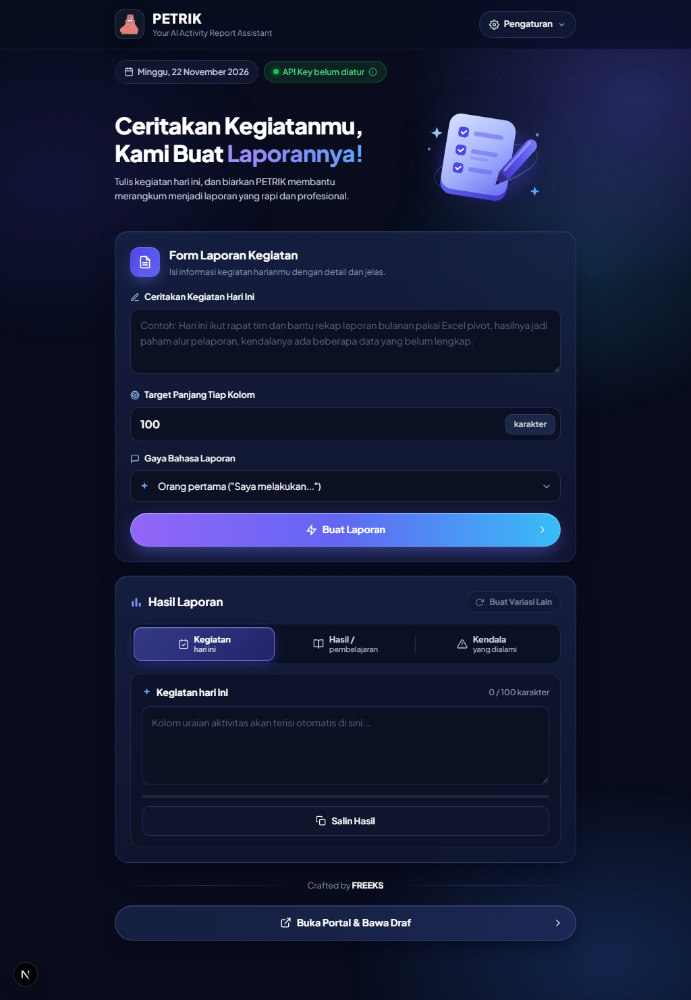

# PETRIK — Your AI Activity Report Assistant

**PETRIK** adalah aplikasi web PWA (*Progressive Web App*) berbasis **Next.js** yang membantu peserta magang (program **MagangHub Kemnaker**) mengubah satu catatan singkat kegiatan harian menjadi **3 kolom laporan formal** yang siap disalin atau dibawa langsung ke portal Monev MagangHub (`monev.maganghub.kemnaker.go.id`).

> **Prinsip Keamanan & Integritas:** Aplikasi ini **sengaja tidak** menekan tombol *Simpan dan Kirim*, tidak mencentang pernyataan "telah meninjau", dan tidak menyentuh data lokasi. Pengguna tetap memeriksa dan mengirim laporan secara manual.

---

## Tampilan Aplikasi

<p align="center">
  
</p>

---

## Fitur Utama

- **1 Input → 3 Kolom Laporan Otomatis** — Cukup tulis ringkasan kegiatan hari ini dalam satu kotak; Gemini AI akan memilah dan menyusunnya menjadi:
  1. **Kegiatan hari ini** (*Uraian aktivitas*)
  2. **Hasil Pembelajaran** (*Pembelajaran yang diperoleh*)
  3. **Kendala yang dialami**
- **Kontrol Panjang Karakter Otomatis** — Menjaga panjang teks tiap kolom sesuai target (default `100` karakter, dapat diatur 50–1000 karakter) dengan *auto-retry* hingga 3 kali bila keluar dari rentang.
- **Pilihan Gaya Bahasa** — Mendukung sudut pandang orang pertama (`"Saya melakukan..."`) atau tanpa subjek (`"Melakukan..."`).
- **Tampilan Tab Interaktif & Penghitung Karakter** — Edit langsung tiap kolom, lihat indikator panjang karakter (*progress bar*), buat variasi lain, atau salin hasil dengan satu klik.
- **Bawa Draf ke Portal (Userscript)** — Tombol **Buka Portal & Bawa Draf** membawa 3 kolom laporan lewat URL `#hash` (tidak dikirim ke server mana pun) agar terisi otomatis menggunakan userscript [`public/monev-autofill.user.js`](public/monev-autofill.user.js).
- **Siap Dipasang sebagai PWA** — Bisa di-install ke layar utama HP Android maupun iOS, lengkap dengan penyimpanan draf otomatis di `localStorage`.

---

## Teknologi yang Digunakan

- **Framework:** Next.js 15 (App Router) & React 19
- **Bahasa:** TypeScript
- **AI Engine:** Google Gemini API (default `gemini-2.5-flash`)
- **PWA:** Web App Manifest & Service Worker (`public/sw.js`)
- **Otomasi Form Portal:** Userscript (`public/monev-autofill.user.js`)

---

## Cara Menjalankan Secara Lokal

1. **Clone repository:**
   ```bash
   git clone https://github.com/Faliqulxx/assmonV1.git
   cd assmonV1
   ```

2. **Install dependensi:**
   ```bash
   npm install
   ```

3. **(Opsional) Atur API Key di environment:**
   Buat file `.env.local` lalu isi:
   ```env
   GEMINI_API_KEY=your_gemini_api_key_here
   ```
   *(Atau tempel langsung API Key melalui tombol **Pengaturan** di dalam aplikasi — didapatkan gratis di [Google AI Studio](https://aistudio.google.com/apikey)).*

4. **Jalankan server pengembangan:**
   ```bash
   npm run dev
   ```
   Buka [http://localhost:3000](http://localhost:3000) di browser.

---

## Pengisian Otomatis ke Portal (Userscript)

1. Pasang ekstensi **Violentmonkey** (di Firefox Android atau browser desktop).
2. Pasang skrip [`public/monev-autofill.user.js`](public/monev-autofill.user.js).
3. Setelah membuat laporan di PETRIK, tekan **Buka Portal & Bawa Draf**.
4. Login SIAPkerja seperti biasa, buka **Riwayat Kehadiran → Tambah laporan** — ketiga kolom akan terisi otomatis jika masih kosong (atau tekan tombol **Isi dari draf** di pojok kanan bawah).
5. Periksa isian, tambahkan lokasi, centang pernyataan, lalu kirim sendiri.

---

## Struktur Project

```text
├── app/
│   ├── api/generate/route.ts   # Endpoint pemanggil Gemini AI & validasi panjang karakter
│   ├── globals.css             # Styling & efek antarmuka
│   ├── layout.tsx              # Metadata PWA, viewport, dan font
│   └── page.tsx                # Halaman utama aplikasi PETRIK
├── docs/
│   └── screenshot.png          # Tangkapan layar tampilan aplikasi
├── public/
│   ├── icon-192.png            # Ikon aplikasi 192×192
│   ├── icon-512.png            # Ikon aplikasi 512×512
│   ├── icon-maskable-512.png   # Ikon maskable Android
│   ├── manifest.json           # Konfigurasi PWA
│   ├── monev-autofill.user.js  # Userscript pengisi form portal Monev
│   └── sw.js                   # Service Worker (cache offline)
├── PANDUAN.md                  # Panduan penggunaan singkat
└── package.json
```

---

Crafted by **FREEKS**
